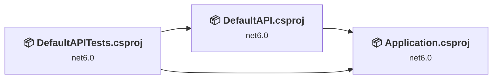
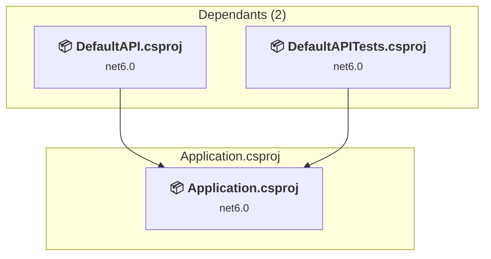
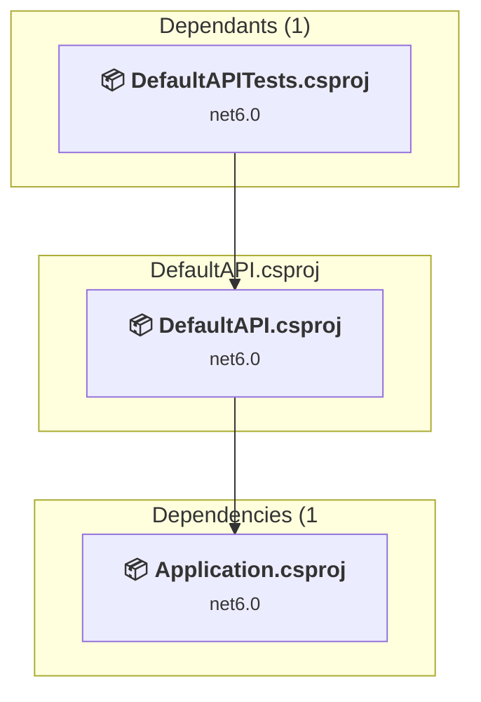
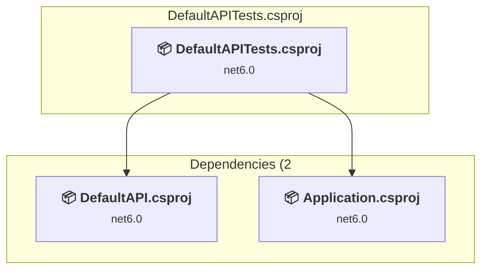

# Projects and dependencies analysis

This document provides a comprehensive overview of the projects and their dependencies in the context of upgrading to .NETCoreApp,Version=v10.0.

## Table of Contents

- [Executive Summary](#executive-Summary)
  - [Highlevel Metrics](#highlevel-metrics)
  - [Projects Compatibility](#projects-compatibility)
  - [Package Compatibility](#package-compatibility)
  - [API Compatibility](#api-compatibility)
  - [Binding Redirect Configuration](#binding-redirect-configuration)
- [Aggregate NuGet packages details](#aggregate-nuget-packages-details)
- [Top API Migration Challenges](#top-api-migration-challenges)
  - [Technologies and Features](#technologies-and-features)
  - [Most Frequent API Issues](#most-frequent-api-issues)
- [Projects Relationship Graph](#projects-relationship-graph)
- [Project Details](#project-details)

  - [Application\Application.csproj](#applicationapplicationcsproj)
  - [DefaultAPI\DefaultAPI.csproj](#defaultapidefaultapicsproj)
  - [DefaultAPITests\DefaultAPITests.csproj](#defaultapitestsdefaultapitestscsproj)

## Executive Summary

### Highlevel Metrics

| Metric | Count | Status |
| :--- | :---: | :--- |
| Total Projects | 3 | All require upgrade |
| Total NuGet Packages | 139 | 4 need upgrade |
| Total Code Files | 31 |  |
| Total Code Files with Incidents | 6 |  |
| Total Lines of Code | 904 |  |
| Total Number of Issues | 30 |  |
| Estimated LOC to modify | 21+ | at least 2.3% of codebase |

### Projects Compatibility

| Project | Target Framework | Difficulty | Package Issues | API Issues | Binding Issues | Est. LOC Impact | Description |
| :--- | :---: | :---: | :---: | :---: | :---: | :---: | :--- |
| [Application\Application.csproj](#applicationapplicationcsproj) | net6.0 | 🟢 Low | 3 | 10 | 0 | 10+ | ClassLibrary, Sdk Style = True |
| [DefaultAPI\DefaultAPI.csproj](#defaultapidefaultapicsproj) | net6.0 | 🟢 Low | 2 | 11 | 0 | 11+ | AspNetCore, Sdk Style = True |
| [DefaultAPITests\DefaultAPITests.csproj](#defaultapitestsdefaultapitestscsproj) | net6.0 | 🟢 Low | 1 | 0 | 0 |  | DotNetCoreApp, Sdk Style = True |

### Package Compatibility

| Status | Count | Percentage |
| :--- | :---: | :---: |
| ✅ Compatible | 135 | 97.1% |
| ⚠️ Incompatible | 1 | 0.7% |
| 🔄 Upgrade Recommended | 3 | 2.2% |
| ***Total NuGet Packages*** | ***139*** | ***100%*** |

### API Compatibility

| Category | Count | Impact |
| :--- | :---: | :--- |
| 🔴 Binary Incompatible | 9 | High - Require code changes |
| 🟡 Source Incompatible | 10 | Medium - Needs re-compilation and potential conflicting API error fixing |
| 🔵 Behavioral change | 2 | Low - Behavioral changes that may require testing at runtime |
| ✅ Compatible | 922 |  |
| ***Total APIs Analyzed*** | ***943*** |  |

## Aggregate NuGet packages details

| Package | Current Version | Suggested Version | Projects | Description |
| :--- | :---: | :---: | :--- | :--- |
| Autofac | 6.4.0 |  | [Application.csproj](#applicationapplicationcsproj) [DefaultAPI.csproj](#defaultapidefaultapicsproj) [DefaultAPITests.csproj](#defaultapitestsdefaultapitestscsproj) | ✅Compatible |
| Autofac.Extensions.DependencyInjection | 8.0.0 |  | [Application.csproj](#applicationapplicationcsproj) [DefaultAPI.csproj](#defaultapidefaultapicsproj) [DefaultAPITests.csproj](#defaultapitestsdefaultapitestscsproj) | ✅Compatible |
| Castle.Core | 5.1.0 |  | [DefaultAPITests.csproj](#defaultapitestsdefaultapitestscsproj) | ✅Compatible |
| coverlet.collector | 3.1.2 |  | [DefaultAPITests.csproj](#defaultapitestsdefaultapitestscsproj) | ✅Compatible |
| Dapper | 2.0.123 |  | [Application.csproj](#applicationapplicationcsproj) [DefaultAPI.csproj](#defaultapidefaultapicsproj) [DefaultAPITests.csproj](#defaultapitestsdefaultapitestscsproj) | ✅Compatible |
| MassTransit | 8.0.6 |  | [Application.csproj](#applicationapplicationcsproj) [DefaultAPI.csproj](#defaultapidefaultapicsproj) [DefaultAPITests.csproj](#defaultapitestsdefaultapitestscsproj) | ✅Compatible |
| MassTransit.Abstractions | 8.0.6 |  | [Application.csproj](#applicationapplicationcsproj) [DefaultAPI.csproj](#defaultapidefaultapicsproj) [DefaultAPITests.csproj](#defaultapitestsdefaultapitestscsproj) | ✅Compatible |
| MassTransit.AspNetCore | 7.3.1 |  | [Application.csproj](#applicationapplicationcsproj) [DefaultAPI.csproj](#defaultapidefaultapicsproj) [DefaultAPITests.csproj](#defaultapitestsdefaultapitestscsproj) | ✅Compatible |
| MassTransit.Extensions.DependencyInjection | 7.3.1 |  | [Application.csproj](#applicationapplicationcsproj) [DefaultAPI.csproj](#defaultapidefaultapicsproj) [DefaultAPITests.csproj](#defaultapitestsdefaultapitestscsproj) | ✅Compatible |
| MassTransit.RabbitMQ | 8.0.6 |  | [Application.csproj](#applicationapplicationcsproj) [DefaultAPI.csproj](#defaultapidefaultapicsproj) [DefaultAPITests.csproj](#defaultapitestsdefaultapitestscsproj) | ✅Compatible |
| MediatR | 11.0.0 |  | [Application.csproj](#applicationapplicationcsproj) [DefaultAPI.csproj](#defaultapidefaultapicsproj) [DefaultAPITests.csproj](#defaultapitestsdefaultapitestscsproj) | ✅Compatible |
| MediatR.Contracts | 1.0.1 |  | [Application.csproj](#applicationapplicationcsproj) [DefaultAPI.csproj](#defaultapidefaultapicsproj) [DefaultAPITests.csproj](#defaultapitestsdefaultapitestscsproj) | ✅Compatible |
| MediatR.Extensions.Microsoft.DependencyInjection | 11.0.0 |  | [DefaultAPI.csproj](#defaultapidefaultapicsproj) [DefaultAPITests.csproj](#defaultapitestsdefaultapitestscsproj) | ✅Compatible |
| Microsoft.CodeCoverage | 17.1.0 |  | [DefaultAPITests.csproj](#defaultapitestsdefaultapitestscsproj) | ✅Compatible |
| Microsoft.Extensions.ApiDescription.Server | 6.0.5 |  | [Application.csproj](#applicationapplicationcsproj) [DefaultAPI.csproj](#defaultapidefaultapicsproj) [DefaultAPITests.csproj](#defaultapitestsdefaultapitestscsproj) | ✅Compatible |
| Microsoft.Extensions.Configuration.Abstractions | 3.1.18 |  | [Application.csproj](#applicationapplicationcsproj) [DefaultAPI.csproj](#defaultapidefaultapicsproj) [DefaultAPITests.csproj](#defaultapitestsdefaultapitestscsproj) | ✅Compatible |
| Microsoft.Extensions.DependencyInjection | 6.0.0 |  | [Application.csproj](#applicationapplicationcsproj) [DefaultAPI.csproj](#defaultapidefaultapicsproj) [DefaultAPITests.csproj](#defaultapitestsdefaultapitestscsproj) | ✅Compatible |
| Microsoft.Extensions.DependencyInjection.Abstractions | 6.0.0 |  | [Application.csproj](#applicationapplicationcsproj) [DefaultAPI.csproj](#defaultapidefaultapicsproj) [DefaultAPITests.csproj](#defaultapitestsdefaultapitestscsproj) | ✅Compatible |
| Microsoft.Extensions.DependencyModel | 3.1.6 |  | [Application.csproj](#applicationapplicationcsproj) [DefaultAPI.csproj](#defaultapidefaultapicsproj) [DefaultAPITests.csproj](#defaultapitestsdefaultapitestscsproj) | ✅Compatible |
| Microsoft.Extensions.Diagnostics.HealthChecks | 3.1.18 |  | [Application.csproj](#applicationapplicationcsproj) [DefaultAPI.csproj](#defaultapidefaultapicsproj) [DefaultAPITests.csproj](#defaultapitestsdefaultapitestscsproj) | ✅Compatible |
| Microsoft.Extensions.Diagnostics.HealthChecks.Abstractions | 3.1.18 |  | [Application.csproj](#applicationapplicationcsproj) [DefaultAPI.csproj](#defaultapidefaultapicsproj) [DefaultAPITests.csproj](#defaultapitestsdefaultapitestscsproj) | ✅Compatible |
| Microsoft.Extensions.FileProviders.Abstractions | 3.1.18 |  | [Application.csproj](#applicationapplicationcsproj) [DefaultAPI.csproj](#defaultapidefaultapicsproj) [DefaultAPITests.csproj](#defaultapitestsdefaultapitestscsproj) | ✅Compatible |
| Microsoft.Extensions.Hosting.Abstractions | 3.1.18 |  | [Application.csproj](#applicationapplicationcsproj) [DefaultAPI.csproj](#defaultapidefaultapicsproj) [DefaultAPITests.csproj](#defaultapitestsdefaultapitestscsproj) | ✅Compatible |
| Microsoft.Extensions.Logging | 6.0.0 | 10.0.15 | [Application.csproj](#applicationapplicationcsproj) [DefaultAPI.csproj](#defaultapidefaultapicsproj) [DefaultAPITests.csproj](#defaultapitestsdefaultapitestscsproj) | NuGet package upgrade is recommended |
| Microsoft.Extensions.Logging.Abstractions | 6.0.0 |  | [Application.csproj](#applicationapplicationcsproj) [DefaultAPI.csproj](#defaultapidefaultapicsproj) [DefaultAPITests.csproj](#defaultapitestsdefaultapitestscsproj) | ✅Compatible |
| Microsoft.Extensions.Options | 6.0.0 |  | [Application.csproj](#applicationapplicationcsproj) [DefaultAPI.csproj](#defaultapidefaultapicsproj) [DefaultAPITests.csproj](#defaultapitestsdefaultapitestscsproj) | ✅Compatible |
| Microsoft.Extensions.Primitives | 6.0.0 |  | [Application.csproj](#applicationapplicationcsproj) [DefaultAPI.csproj](#defaultapidefaultapicsproj) [DefaultAPITests.csproj](#defaultapitestsdefaultapitestscsproj) | ✅Compatible |
| Microsoft.NET.Test.Sdk | 17.1.0 |  | [DefaultAPITests.csproj](#defaultapitestsdefaultapitestscsproj) | ✅Compatible |
| Microsoft.NETCore.Platforms | 3.1.0 |  | [Application.csproj](#applicationapplicationcsproj) [DefaultAPI.csproj](#defaultapidefaultapicsproj) [DefaultAPITests.csproj](#defaultapitestsdefaultapitestscsproj) | ✅Compatible |
| Microsoft.NETCore.Targets | 1.1.0 |  | [DefaultAPITests.csproj](#defaultapitestsdefaultapitestscsproj) | ✅Compatible |
| Microsoft.OpenApi | 1.3.1 |  | [Application.csproj](#applicationapplicationcsproj) [DefaultAPI.csproj](#defaultapidefaultapicsproj) [DefaultAPITests.csproj](#defaultapitestsdefaultapitestscsproj) | ✅Compatible |
| Microsoft.TestPlatform.ObjectModel | 17.1.0 |  | [DefaultAPITests.csproj](#defaultapitestsdefaultapitestscsproj) | ✅Compatible |
| Microsoft.TestPlatform.TestHost | 17.1.0 |  | [DefaultAPITests.csproj](#defaultapitestsdefaultapitestscsproj) | ✅Compatible |
| Microsoft.Win32.Primitives | 4.3.0 |  | [DefaultAPITests.csproj](#defaultapitestsdefaultapitestscsproj) | ✅Compatible |
| Microsoft.Win32.Registry | 4.7.0 |  | [Application.csproj](#applicationapplicationcsproj) [DefaultAPI.csproj](#defaultapidefaultapicsproj) [DefaultAPITests.csproj](#defaultapitestsdefaultapitestscsproj) | ✅Compatible |
| Moq | 4.18.2 |  | [DefaultAPITests.csproj](#defaultapitestsdefaultapitestscsproj) | ✅Compatible |
| NETStandard.Library | 1.6.1 |  | [DefaultAPITests.csproj](#defaultapitestsdefaultapitestscsproj) | ✅Compatible |
| Newtonsoft.Json | 13.0.1 | 13.0.4 | [Application.csproj](#applicationapplicationcsproj) [DefaultAPI.csproj](#defaultapidefaultapicsproj) [DefaultAPITests.csproj](#defaultapitestsdefaultapitestscsproj) | NuGet package upgrade is recommended |
| NuGet.Frameworks | 5.11.0 |  | [DefaultAPITests.csproj](#defaultapitestsdefaultapitestscsproj) | ✅Compatible |
| Polly | 7.2.3 |  | [Application.csproj](#applicationapplicationcsproj) [DefaultAPI.csproj](#defaultapidefaultapicsproj) [DefaultAPITests.csproj](#defaultapitestsdefaultapitestscsproj) | ✅Compatible |
| RabbitMQ.Client | 6.4.0 |  | [Application.csproj](#applicationapplicationcsproj) [DefaultAPI.csproj](#defaultapidefaultapicsproj) [DefaultAPITests.csproj](#defaultapitestsdefaultapitestscsproj) | ✅Compatible |
| runtime.debian.8-x64.runtime.native.System.Security.Cryptography.OpenSsl | 4.3.0 |  | [DefaultAPITests.csproj](#defaultapitestsdefaultapitestscsproj) | ✅Compatible |
| runtime.fedora.23-x64.runtime.native.System.Security.Cryptography.OpenSsl | 4.3.0 |  | [DefaultAPITests.csproj](#defaultapitestsdefaultapitestscsproj) | ✅Compatible |
| runtime.fedora.24-x64.runtime.native.System.Security.Cryptography.OpenSsl | 4.3.0 |  | [DefaultAPITests.csproj](#defaultapitestsdefaultapitestscsproj) | ✅Compatible |
| runtime.native.System | 4.3.0 |  | [DefaultAPITests.csproj](#defaultapitestsdefaultapitestscsproj) | ✅Compatible |
| runtime.native.System.Data.SqlClient.sni | 4.7.0 |  | [Application.csproj](#applicationapplicationcsproj) [DefaultAPI.csproj](#defaultapidefaultapicsproj) [DefaultAPITests.csproj](#defaultapitestsdefaultapitestscsproj) | ✅Compatible |
| runtime.native.System.IO.Compression | 4.3.0 |  | [DefaultAPITests.csproj](#defaultapitestsdefaultapitestscsproj) | ✅Compatible |
| runtime.native.System.Net.Http | 4.3.0 |  | [DefaultAPITests.csproj](#defaultapitestsdefaultapitestscsproj) | ✅Compatible |
| runtime.native.System.Security.Cryptography.Apple | 4.3.0 |  | [DefaultAPITests.csproj](#defaultapitestsdefaultapitestscsproj) | ✅Compatible |
| runtime.native.System.Security.Cryptography.OpenSsl | 4.3.0 |  | [DefaultAPITests.csproj](#defaultapitestsdefaultapitestscsproj) | ✅Compatible |
| runtime.opensuse.13.2-x64.runtime.native.System.Security.Cryptography.OpenSsl | 4.3.0 |  | [DefaultAPITests.csproj](#defaultapitestsdefaultapitestscsproj) | ✅Compatible |
| runtime.opensuse.42.1-x64.runtime.native.System.Security.Cryptography.OpenSsl | 4.3.0 |  | [DefaultAPITests.csproj](#defaultapitestsdefaultapitestscsproj) | ✅Compatible |
| runtime.osx.10.10-x64.runtime.native.System.Security.Cryptography.Apple | 4.3.0 |  | [DefaultAPITests.csproj](#defaultapitestsdefaultapitestscsproj) | ✅Compatible |
| runtime.osx.10.10-x64.runtime.native.System.Security.Cryptography.OpenSsl | 4.3.0 |  | [DefaultAPITests.csproj](#defaultapitestsdefaultapitestscsproj) | ✅Compatible |
| runtime.rhel.7-x64.runtime.native.System.Security.Cryptography.OpenSsl | 4.3.0 |  | [DefaultAPITests.csproj](#defaultapitestsdefaultapitestscsproj) | ✅Compatible |
| runtime.ubuntu.14.04-x64.runtime.native.System.Security.Cryptography.OpenSsl | 4.3.0 |  | [DefaultAPITests.csproj](#defaultapitestsdefaultapitestscsproj) | ✅Compatible |
| runtime.ubuntu.16.04-x64.runtime.native.System.Security.Cryptography.OpenSsl | 4.3.0 |  | [DefaultAPITests.csproj](#defaultapitestsdefaultapitestscsproj) | ✅Compatible |
| runtime.ubuntu.16.10-x64.runtime.native.System.Security.Cryptography.OpenSsl | 4.3.0 |  | [DefaultAPITests.csproj](#defaultapitestsdefaultapitestscsproj) | ✅Compatible |
| runtime.win-arm64.runtime.native.System.Data.SqlClient.sni | 4.4.0 |  | [Application.csproj](#applicationapplicationcsproj) [DefaultAPI.csproj](#defaultapidefaultapicsproj) [DefaultAPITests.csproj](#defaultapitestsdefaultapitestscsproj) | ✅Compatible |
| runtime.win-x64.runtime.native.System.Data.SqlClient.sni | 4.4.0 |  | [Application.csproj](#applicationapplicationcsproj) [DefaultAPI.csproj](#defaultapidefaultapicsproj) [DefaultAPITests.csproj](#defaultapitestsdefaultapitestscsproj) | ✅Compatible |
| runtime.win-x86.runtime.native.System.Data.SqlClient.sni | 4.4.0 |  | [Application.csproj](#applicationapplicationcsproj) [DefaultAPI.csproj](#defaultapidefaultapicsproj) [DefaultAPITests.csproj](#defaultapitestsdefaultapitestscsproj) | ✅Compatible |
| Scrutor | 3.3.0 |  | [Application.csproj](#applicationapplicationcsproj) [DefaultAPI.csproj](#defaultapidefaultapicsproj) [DefaultAPITests.csproj](#defaultapitestsdefaultapitestscsproj) | ✅Compatible |
| Swashbuckle.AspNetCore | 6.4.0 |  | [Application.csproj](#applicationapplicationcsproj) [DefaultAPI.csproj](#defaultapidefaultapicsproj) [DefaultAPITests.csproj](#defaultapitestsdefaultapitestscsproj) | ✅Compatible |
| Swashbuckle.AspNetCore.Filters | 7.0.5 |  | [Application.csproj](#applicationapplicationcsproj) [DefaultAPI.csproj](#defaultapidefaultapicsproj) [DefaultAPITests.csproj](#defaultapitestsdefaultapitestscsproj) | ✅Compatible |
| Swashbuckle.AspNetCore.Filters.Abstractions | 7.0.5 |  | [Application.csproj](#applicationapplicationcsproj) [DefaultAPI.csproj](#defaultapidefaultapicsproj) [DefaultAPITests.csproj](#defaultapitestsdefaultapitestscsproj) | ✅Compatible |
| Swashbuckle.AspNetCore.Swagger | 6.4.0 |  | [Application.csproj](#applicationapplicationcsproj) [DefaultAPI.csproj](#defaultapidefaultapicsproj) [DefaultAPITests.csproj](#defaultapitestsdefaultapitestscsproj) | ✅Compatible |
| Swashbuckle.AspNetCore.SwaggerGen | 6.4.0 |  | [Application.csproj](#applicationapplicationcsproj) [DefaultAPI.csproj](#defaultapidefaultapicsproj) [DefaultAPITests.csproj](#defaultapitestsdefaultapitestscsproj) | ✅Compatible |
| Swashbuckle.AspNetCore.SwaggerUI | 6.4.0 |  | [Application.csproj](#applicationapplicationcsproj) [DefaultAPI.csproj](#defaultapidefaultapicsproj) [DefaultAPITests.csproj](#defaultapitestsdefaultapitestscsproj) | ✅Compatible |
| System.AppContext | 4.3.0 |  | [DefaultAPITests.csproj](#defaultapitestsdefaultapitestscsproj) | ✅Compatible |
| System.Buffers | 4.3.0 |  | [DefaultAPITests.csproj](#defaultapitestsdefaultapitestscsproj) | ✅Compatible |
| System.Collections | 4.3.0 |  | [DefaultAPITests.csproj](#defaultapitestsdefaultapitestscsproj) | ✅Compatible |
| System.Collections.Concurrent | 4.3.0 |  | [DefaultAPITests.csproj](#defaultapitestsdefaultapitestscsproj) | ✅Compatible |
| System.Console | 4.3.0 |  | [DefaultAPITests.csproj](#defaultapitestsdefaultapitestscsproj) | ✅Compatible |
| System.Data.SqlClient | 4.8.3 | 4.9.1 | [Application.csproj](#applicationapplicationcsproj) [DefaultAPI.csproj](#defaultapidefaultapicsproj) [DefaultAPITests.csproj](#defaultapitestsdefaultapitestscsproj) | Replace with Microsoft.Data.SqlClient: Change namespace; mostly API-compatible; install NuGet package in all projects |
| System.Diagnostics.Debug | 4.3.0 |  | [DefaultAPITests.csproj](#defaultapitestsdefaultapitestscsproj) | ✅Compatible |
| System.Diagnostics.DiagnosticSource | 6.0.0 |  | [Application.csproj](#applicationapplicationcsproj) [DefaultAPI.csproj](#defaultapidefaultapicsproj) [DefaultAPITests.csproj](#defaultapitestsdefaultapitestscsproj) | ✅Compatible |
| System.Diagnostics.EventLog | 6.0.0 |  | [DefaultAPITests.csproj](#defaultapitestsdefaultapitestscsproj) | ✅Compatible |
| System.Diagnostics.Tools | 4.3.0 |  | [DefaultAPITests.csproj](#defaultapitestsdefaultapitestscsproj) | ✅Compatible |
| System.Diagnostics.Tracing | 4.3.0 |  | [DefaultAPITests.csproj](#defaultapitestsdefaultapitestscsproj) | ✅Compatible |
| System.Globalization | 4.3.0 |  | [DefaultAPITests.csproj](#defaultapitestsdefaultapitestscsproj) | ✅Compatible |
| System.Globalization.Calendars | 4.3.0 |  | [DefaultAPITests.csproj](#defaultapitestsdefaultapitestscsproj) | ✅Compatible |
| System.Globalization.Extensions | 4.3.0 |  | [DefaultAPITests.csproj](#defaultapitestsdefaultapitestscsproj) | ✅Compatible |
| System.IO | 4.3.0 |  | [DefaultAPITests.csproj](#defaultapitestsdefaultapitestscsproj) | ✅Compatible |
| System.IO.Compression | 4.3.0 |  | [DefaultAPITests.csproj](#defaultapitestsdefaultapitestscsproj) | ✅Compatible |
| System.IO.Compression.ZipFile | 4.3.0 |  | [DefaultAPITests.csproj](#defaultapitestsdefaultapitestscsproj) | ✅Compatible |
| System.IO.FileSystem | 4.3.0 |  | [DefaultAPITests.csproj](#defaultapitestsdefaultapitestscsproj) | ✅Compatible |
| System.IO.FileSystem.Primitives | 4.3.0 |  | [DefaultAPITests.csproj](#defaultapitestsdefaultapitestscsproj) | ✅Compatible |
| System.Linq | 4.3.0 |  | [DefaultAPITests.csproj](#defaultapitestsdefaultapitestscsproj) | ✅Compatible |
| System.Linq.Expressions | 4.3.0 |  | [DefaultAPITests.csproj](#defaultapitestsdefaultapitestscsproj) | ✅Compatible |
| System.Memory | 4.5.4 |  | [Application.csproj](#applicationapplicationcsproj) [DefaultAPI.csproj](#defaultapidefaultapicsproj) [DefaultAPITests.csproj](#defaultapitestsdefaultapitestscsproj) | ✅Compatible |
| System.Net.Http | 4.3.0 |  | [DefaultAPITests.csproj](#defaultapitestsdefaultapitestscsproj) | ✅Compatible |
| System.Net.Primitives | 4.3.0 |  | [DefaultAPITests.csproj](#defaultapitestsdefaultapitestscsproj) | ✅Compatible |
| System.Net.Sockets | 4.3.0 |  | [DefaultAPITests.csproj](#defaultapitestsdefaultapitestscsproj) | ✅Compatible |
| System.ObjectModel | 4.3.0 |  | [DefaultAPITests.csproj](#defaultapitestsdefaultapitestscsproj) | ✅Compatible |
| System.Reflection | 4.3.0 |  | [DefaultAPITests.csproj](#defaultapitestsdefaultapitestscsproj) | ✅Compatible |
| System.Reflection.Emit | 4.7.0 |  | [Application.csproj](#applicationapplicationcsproj) [DefaultAPI.csproj](#defaultapidefaultapicsproj) [DefaultAPITests.csproj](#defaultapitestsdefaultapitestscsproj) | ✅Compatible |
| System.Reflection.Emit.ILGeneration | 4.3.0 |  | [DefaultAPITests.csproj](#defaultapitestsdefaultapitestscsproj) | ✅Compatible |
| System.Reflection.Emit.Lightweight | 4.7.0 |  | [Application.csproj](#applicationapplicationcsproj) [DefaultAPI.csproj](#defaultapidefaultapicsproj) [DefaultAPITests.csproj](#defaultapitestsdefaultapitestscsproj) | ✅Compatible |
| System.Reflection.Extensions | 4.3.0 |  | [DefaultAPITests.csproj](#defaultapitestsdefaultapitestscsproj) | ✅Compatible |
| System.Reflection.Metadata | 1.6.0 |  | [DefaultAPITests.csproj](#defaultapitestsdefaultapitestscsproj) | ✅Compatible |
| System.Reflection.Primitives | 4.3.0 |  | [DefaultAPITests.csproj](#defaultapitestsdefaultapitestscsproj) | ✅Compatible |
| System.Reflection.TypeExtensions | 4.3.0 |  | [DefaultAPITests.csproj](#defaultapitestsdefaultapitestscsproj) | ✅Compatible |
| System.Resources.ResourceManager | 4.3.0 |  | [DefaultAPITests.csproj](#defaultapitestsdefaultapitestscsproj) | ✅Compatible |
| System.Runtime | 4.3.0 |  | [DefaultAPITests.csproj](#defaultapitestsdefaultapitestscsproj) | ✅Compatible |
| System.Runtime.CompilerServices.Unsafe | 6.0.0 |  | [Application.csproj](#applicationapplicationcsproj) [DefaultAPI.csproj](#defaultapidefaultapicsproj) [DefaultAPITests.csproj](#defaultapitestsdefaultapitestscsproj) | ✅Compatible |
| System.Runtime.Extensions | 4.3.0 |  | [DefaultAPITests.csproj](#defaultapitestsdefaultapitestscsproj) | ✅Compatible |
| System.Runtime.Handles | 4.3.0 |  | [DefaultAPITests.csproj](#defaultapitestsdefaultapitestscsproj) | ✅Compatible |
| System.Runtime.InteropServices | 4.3.0 |  | [DefaultAPITests.csproj](#defaultapitestsdefaultapitestscsproj) | ✅Compatible |
| System.Runtime.InteropServices.RuntimeInformation | 4.3.0 |  | [DefaultAPITests.csproj](#defaultapitestsdefaultapitestscsproj) | ✅Compatible |
| System.Runtime.Numerics | 4.3.0 |  | [DefaultAPITests.csproj](#defaultapitestsdefaultapitestscsproj) | ✅Compatible |
| System.Security.AccessControl | 4.7.0 |  | [Application.csproj](#applicationapplicationcsproj) [DefaultAPI.csproj](#defaultapidefaultapicsproj) [DefaultAPITests.csproj](#defaultapitestsdefaultapitestscsproj) | ✅Compatible |
| System.Security.Cryptography.Algorithms | 4.3.0 |  | [DefaultAPITests.csproj](#defaultapitestsdefaultapitestscsproj) | ✅Compatible |
| System.Security.Cryptography.Cng | 4.3.0 |  | [DefaultAPITests.csproj](#defaultapitestsdefaultapitestscsproj) | ✅Compatible |
| System.Security.Cryptography.Csp | 4.3.0 |  | [DefaultAPITests.csproj](#defaultapitestsdefaultapitestscsproj) | ✅Compatible |
| System.Security.Cryptography.Encoding | 4.3.0 |  | [DefaultAPITests.csproj](#defaultapitestsdefaultapitestscsproj) | ✅Compatible |
| System.Security.Cryptography.OpenSsl | 4.3.0 |  | [DefaultAPITests.csproj](#defaultapitestsdefaultapitestscsproj) | ✅Compatible |
| System.Security.Cryptography.Primitives | 4.3.0 |  | [DefaultAPITests.csproj](#defaultapitestsdefaultapitestscsproj) | ✅Compatible |
| System.Security.Cryptography.X509Certificates | 4.3.0 |  | [DefaultAPITests.csproj](#defaultapitestsdefaultapitestscsproj) | ✅Compatible |
| System.Security.Principal.Windows | 4.7.0 |  | [Application.csproj](#applicationapplicationcsproj) [DefaultAPI.csproj](#defaultapidefaultapicsproj) [DefaultAPITests.csproj](#defaultapitestsdefaultapitestscsproj) | ✅Compatible |
| System.Text.Encoding | 4.3.0 |  | [DefaultAPITests.csproj](#defaultapitestsdefaultapitestscsproj) | ✅Compatible |
| System.Text.Encoding.Extensions | 4.3.0 |  | [DefaultAPITests.csproj](#defaultapitestsdefaultapitestscsproj) | ✅Compatible |
| System.Text.Encodings.Web | 6.0.0 |  | [Application.csproj](#applicationapplicationcsproj) [DefaultAPI.csproj](#defaultapidefaultapicsproj) [DefaultAPITests.csproj](#defaultapitestsdefaultapitestscsproj) | ✅Compatible |
| System.Text.Json | 6.0.2 |  | [Application.csproj](#applicationapplicationcsproj) [DefaultAPI.csproj](#defaultapidefaultapicsproj) [DefaultAPITests.csproj](#defaultapitestsdefaultapitestscsproj) | ✅Compatible |
| System.Text.RegularExpressions | 4.3.0 |  | [DefaultAPITests.csproj](#defaultapitestsdefaultapitestscsproj) | ✅Compatible |
| System.Threading | 4.3.0 |  | [DefaultAPITests.csproj](#defaultapitestsdefaultapitestscsproj) | ✅Compatible |
| System.Threading.Channels | 6.0.0 |  | [Application.csproj](#applicationapplicationcsproj) [DefaultAPI.csproj](#defaultapidefaultapicsproj) [DefaultAPITests.csproj](#defaultapitestsdefaultapitestscsproj) | ✅Compatible |
| System.Threading.Tasks | 4.3.0 |  | [DefaultAPITests.csproj](#defaultapitestsdefaultapitestscsproj) | ✅Compatible |
| System.Threading.Tasks.Extensions | 4.3.0 |  | [DefaultAPITests.csproj](#defaultapitestsdefaultapitestscsproj) | ✅Compatible |
| System.Threading.Timer | 4.3.0 |  | [DefaultAPITests.csproj](#defaultapitestsdefaultapitestscsproj) | ✅Compatible |
| System.Xml.ReaderWriter | 4.3.0 |  | [DefaultAPITests.csproj](#defaultapitestsdefaultapitestscsproj) | ✅Compatible |
| System.Xml.XDocument | 4.3.0 |  | [DefaultAPITests.csproj](#defaultapitestsdefaultapitestscsproj) | ✅Compatible |
| xunit | 2.4.1 |  | [DefaultAPITests.csproj](#defaultapitestsdefaultapitestscsproj) | ⚠️NuGet package is deprecated |
| xunit.abstractions | 2.0.3 |  | [DefaultAPITests.csproj](#defaultapitestsdefaultapitestscsproj) | ✅Compatible |
| xunit.analyzers | 0.10.0 |  | [DefaultAPITests.csproj](#defaultapitestsdefaultapitestscsproj) | ✅Compatible |
| xunit.assert | 2.4.1 |  | [DefaultAPITests.csproj](#defaultapitestsdefaultapitestscsproj) | ✅Compatible |
| xunit.core | 2.4.1 |  | [DefaultAPITests.csproj](#defaultapitestsdefaultapitestscsproj) | ✅Compatible |
| xunit.extensibility.core | 2.4.1 |  | [DefaultAPITests.csproj](#defaultapitestsdefaultapitestscsproj) | ✅Compatible |
| xunit.extensibility.execution | 2.4.1 |  | [DefaultAPITests.csproj](#defaultapitestsdefaultapitestscsproj) | ✅Compatible |
| xunit.runner.visualstudio | 2.4.3 |  | [DefaultAPITests.csproj](#defaultapitestsdefaultapitestscsproj) | ✅Compatible |

## Top API Migration Challenges

### Technologies and Features

| Technology | Issues | Percentage | Migration Path |
| :--- | :---: | :---: | :--- |

### Most Frequent API Issues

| API | Count | Percentage | Category |
| :--- | :---: | :---: | :--- |
| M:Microsoft.Extensions.Configuration.ConfigurationBinder.GetValue''1(Microsoft.Extensions.Configuration.IConfiguration,System.String) | 7 | 33.3% | Binary Incompatible |
| M:System.TimeSpan.FromSeconds(System.Double) | 4 | 19.0% | Source Incompatible |
| T:System.Data.SqlClient.SqlException | 4 | 19.0% | Source Incompatible |
| M:Microsoft.Extensions.DependencyInjection.OptionsConfigurationServiceCollectionExtensions.Configure''1(Microsoft.Extensions.DependencyInjection.IServiceCollection,Microsoft.Extensions.Configuration.IConfiguration) | 2 | 9.5% | Binary Incompatible |
| T:System.Data.SqlClient.SqlConnection | 1 | 4.8% | Source Incompatible |
| M:System.Data.SqlClient.SqlConnection.#ctor(System.String) | 1 | 4.8% | Source Incompatible |
| T:System.Uri | 1 | 4.8% | Behavioral Change |
| M:System.Uri.#ctor(System.String) | 1 | 4.8% | Behavioral Change |

## Projects Relationship Graph

Legend:
📦 SDK-style project
⚙️ Classic project

## Project Details

### Application\Application.csproj

#### Project Info

- **Current Target Framework:** net6.0
- **Proposed Target Framework:** net10.0
- **SDK-style**: True
- **Project Kind:** ClassLibrary
- **Dependencies**: 0
- **Dependants**: 2
- **Number of Files**: 27
- **Number of Files with Incidents**: 3
- **Lines of Code**: 636
- **Estimated LOC to modify**: 10+ (at least 1.6% of the project)

#### Dependency Graph

Legend:
📦 SDK-style project
⚙️ Classic project

### API Compatibility

| Category | Count | Impact |
| :--- | :---: | :--- |
| 🔴 Binary Incompatible | 0 | High - Require code changes |
| 🟡 Source Incompatible | 10 | Medium - Needs re-compilation and potential conflicting API error fixing |
| 🔵 Behavioral change | 0 | Low - Behavioral changes that may require testing at runtime |
| ✅ Compatible | 573 |  |
| ***Total APIs Analyzed*** | ***583*** |  |

### DefaultAPI\DefaultAPI.csproj

#### Project Info

- **Current Target Framework:** net6.0
- **Proposed Target Framework:** net10.0
- **SDK-style**: True
- **Project Kind:** AspNetCore
- **Dependencies**: 1
- **Dependants**: 1
- **Number of Files**: 5
- **Number of Files with Incidents**: 2
- **Lines of Code**: 224
- **Estimated LOC to modify**: 11+ (at least 4.9% of the project)

#### Dependency Graph

Legend:
📦 SDK-style project
⚙️ Classic project

### API Compatibility

| Category | Count | Impact |
| :--- | :---: | :--- |
| 🔴 Binary Incompatible | 9 | High - Require code changes |
| 🟡 Source Incompatible | 0 | Medium - Needs re-compilation and potential conflicting API error fixing |
| 🔵 Behavioral change | 2 | Low - Behavioral changes that may require testing at runtime |
| ✅ Compatible | 306 |  |
| ***Total APIs Analyzed*** | ***317*** |  |

### DefaultAPITests\DefaultAPITests.csproj

#### Project Info

- **Current Target Framework:** net6.0
- **Proposed Target Framework:** net10.0
- **SDK-style**: True
- **Project Kind:** DotNetCoreApp
- **Dependencies**: 2
- **Dependants**: 0
- **Number of Files**: 6
- **Number of Files with Incidents**: 1
- **Lines of Code**: 44
- **Estimated LOC to modify**: 0+ (at least 0.0% of the project)

#### Dependency Graph

Legend:
📦 SDK-style project
⚙️ Classic project

### API Compatibility

| Category | Count | Impact |
| :--- | :---: | :--- |
| 🔴 Binary Incompatible | 0 | High - Require code changes |
| 🟡 Source Incompatible | 0 | Medium - Needs re-compilation and potential conflicting API error fixing |
| 🔵 Behavioral change | 0 | Low - Behavioral changes that may require testing at runtime |
| ✅ Compatible | 43 |  |
| ***Total APIs Analyzed*** | ***43*** |  |

